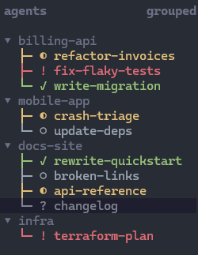

# herdr-agents-tree

Shows herdr's Agents sidebar as a tree: each workspace is a header, its agents sit underneath with a status glyph and
colour. It draws nothing itself. It writes per-pane metadata tokens that your sidebar layout renders. Clicking a row
focuses the agent (stock herdr behaviour).

```
▾ my-project
├─ ○ Fix login redirect
├─ ✓ Add export endpoint
└─ ◐ Write release notes
```



Requires herdr >= 0.9.5 and Node (any recent version) on PATH. Written for Windows, Linux and macOS. It is pure Node and
calls herdr through `HERDR_BIN_PATH`. Tested on Windows and Linux, not yet macOS. Config path outside Windows:
`~/.config/herdr/config.toml`.

## Install

```powershell
herdr plugin link C:\path\to\this\folder
```

## Required config (`%APPDATA%\herdr\config.toml`)

The plugin cannot write client config, so add this yourself and run `herdr server reload-config`:

```toml
[ui]
agent_panel_sort = "spaces"      # keeps each workspace's agents together

[ui.sidebar.agents]
rows = [
  ["$ws_header"],                # set only on the first agent of each workspace -> header row
  [
    { token = "$t_working", fg = "#e5c07b" },
    { token = "$t_blocked", fg = "#e06c75" },
    { token = "$t_done",    fg = "#98c379" },
    { token = "$t_idle",    fg = "#9aa5b1" },
    { token = "$t_unknown", fg = "#7f848e" },
  ],
]
```

Exactly one `$t_<status>` token is set per agent, so exactly one is shown, in that status's colour.

The panel's sort label (top right of the Agents panel) must read **`grouped`**. If it says `priority`, click it. In
`priority` order workspaces interleave and the headers land on the wrong rows.

Optional: the plugin also writes `$tp` (connector) and `$tl` (label), so you can use herdr's own colored status icon
instead: `rows = [["$ws_header"], ["$tp", "state_icon", "$tl"]]`.

## Plugin config (optional)

Put a `config.json` in the plugin's config directory (`herdr plugin config-dir harrisonhjones.herdr-tui-agents-tree`):

```json
{ "show_agent_kind": true }
```

- `show_agent_kind`: prefix each label with the agent's kind, e.g. `claude Fix login redirect` or `kiro tab 3`. Off
  unless set to `true`. The prefix doesn't count toward `AGENTS_TREE_MAX_LABEL`.

The file is read on every run, so changes show on the next event or `refresh`. An unreadable or invalid file is ignored
and logged to the plugin's stderr.

## Actions

- `herdr plugin action invoke harrisonhjones.herdr-tui-agents-tree.refresh` forces a reconcile.
- `...clear` removes every token this plugin wrote (the sidebar rows go blank).
- `...doctor` prints the tree it would write without changing anything.
- `...demo` relabels your real agent rows with fake workspaces (billing-api, mobile-app, docs-site, ...), fake agent
  names and a mix of all five statuses (working, blocked, done, idle, unknown), so you can see the styling or take a
  screenshot without exposing real session names. Nothing real is renamed; it only changes the sidebar tokens. It stays
  on across events until you run `...demo-off`.

## Notes

- Every event (pane/tab/workspace changes, agent status changes) runs one idempotent reconcile and writes only
  changed panes. Runs are serialized by a lock under `HERDR_PLUGIN_STATE_DIR`.
- Status `done` means finished and not yet seen by the server. It can differ from the sidebar's per-client badge.
- Label = the first descriptive one of: the agent name, the tab label, the terminal title. Skipped as not descriptive:
  agent names herdr generates from the pane ID (e.g. `r-wh-p7` for pane `wH:p7`), tab labels that are only a number,
  and the terminal title `Claude Code`. If none is left, the label is `tab <tab label>`, or the agent kind if the tab
  has no label. `AGENTS_TREE_MAX_LABEL` (default 22) truncates it.
- Alignment: herdr indents an entry's first row by 1 and later rows by 3, and trims leading whitespace from token
  values. Agents without a header row are padded with `AGENTS_TREE_PAD` (default 2) U+2800 characters so connectors
  line up. Override the character with `AGENTS_TREE_PAD_CHAR`.
- Without the plugin (or after `clear`) the agent rows are blank, because the layout only shows plugin tokens.
- To uninstall cleanly: run `clear`, `herdr plugin unlink harrisonhjones.herdr-tui-agents-tree`, and restore your config.

## License

MIT. See [LICENSE](LICENSE).
